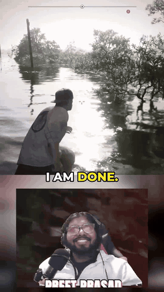
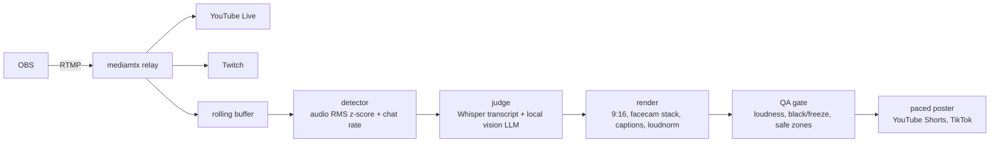
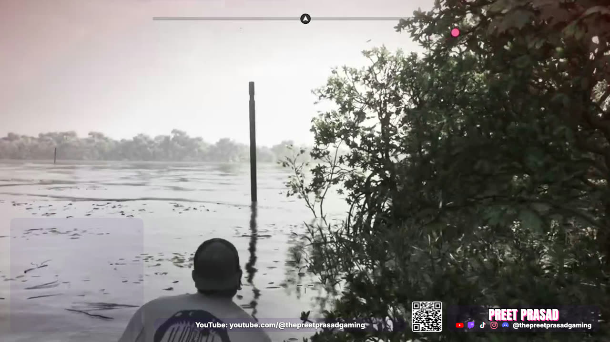
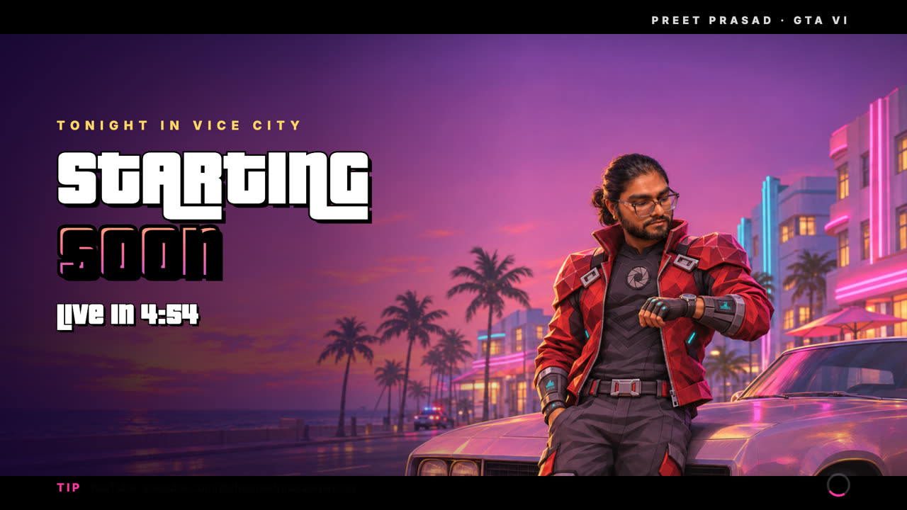
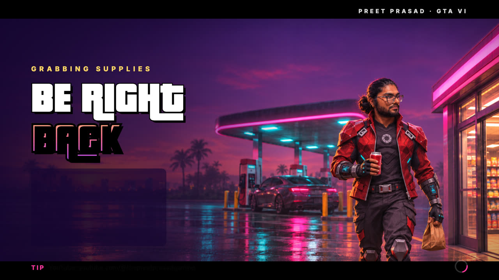
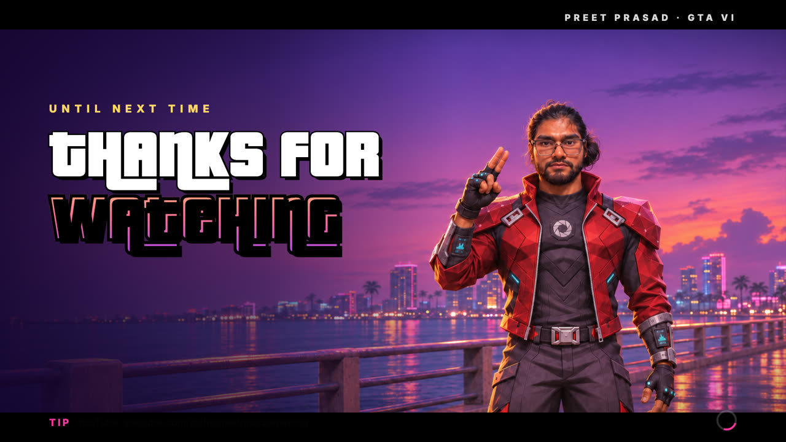

# Streamwright

**A local, free streaming co-pilot for any game, on macOS.** OBS streams once. Streamwright simulcasts to YouTube Live and Twitch,
runs your overlays and chat bot, writes stream titles and thumbnails in the game's own visual style, watches the stream
for highlight moments, and turns them into captioned vertical Shorts for YouTube Shorts and TikTok. Everything runs on one Mac,
with local AI models and no paid API keys. Set the game's name in `.env` and the titles, thumbnails, clip judging and overlay text adapt to it.

<p align="center"><br><sub>A Short Streamwright found, cut and captioned from an 8.4-hour stream recording.</sub></p>

## What it does



- **Simulcast relay:** one OBS output is forwarded to YouTube and Twitch by mediamtx, so the upload is only needed once.
- **Highlight detection:** a robust z-score of per-second loudness, combined with chat activity, finds candidate moments.
- **Local judging:** whisper.cpp transcribes the window and snaps the cut points to gaps between words. A local
  vision model (Ollama, `qwen3-vl:8b`) scores hook, payoff and whether the clip stands alone. A Claude judge can be added (off by default).
- **Rendering:** ffmpeg builds a 9:16 frame with the gameplay stacked over a detected facecam (YuNet), word-by-word
  captions and loudness normalisation.
- **QA gate:** clips with bad loudness, black or frozen frames, or captions outside the safe zone are never posted.
- **Paced posting:** a queue respects platform quotas (it waits for YouTube's Pacific-midnight reset and backs off
  when TikTok limits pending drafts).
- **VOD mining:** `scripts/replay_vod.py` runs the same pipeline over a finished recording. Review strips
  (`scripts/review_sheets.sh`) gate what gets posted, because local models can describe a moment wrongly.
- **Stream extras:** chat bot and OBS overlays (`kit/chatbot.py`), stream titles and thumbnails (`kit/stream_meta.py`).

**Real run:** one 8.4-hour GTA VI stream was mined into 47 candidate clips. 19 passed review and were posted as Shorts before the next stream.

**Stack:** Python 3.12, ffmpeg, mediamtx, whisper.cpp, Ollama, OpenCV (YuNet), YouTube Data API, TikTok Content Posting API.

**Privacy by design:** credentials live in `.env` and `secrets/` (git-ignored, `chmod 600`). Stream keys are written
only to a generated, git-ignored config and are never printed. Recordings, clips and voice data stay on the machine.

## Overlays

OBS Browser Sources served locally by the chat bot. Name, game label, links and countdown come from `.env`.

| In-game layout (`/layout`) | Starting soon (`/starting?min=5`) |
|---|---|
|  |  |
| **Be right back (`/brb`)** | **Ending (`/ending`)** |
|  |  |

## Bring your own game

The screenshots and demo come from a Grand Theft Auto VI stream, but nothing in the pipeline is tied to GTA. To stream another game:

| Set in `.env` | What changes |
|---|---|
| `STREAM_GAME=Elden Ring` | Clip-judge prompt, stream titles and descriptions, thumbnail style, promo hashtags |
| `STREAM_GAME_SHORT=ELDEN RING` | Game label on the overlay scenes |
| `STREAMER_NAME=Your Name` | Overlay name plate and go-live promo text (blank = your channel handle) |
| `STREAM_ANGLE=...` | The story your titles tell (blank = "first time ever playing <game>") |
| `SCENE_KICKER=...` | The line above STARTING SOON (blank = "Tonight on stream") |
| `LINK_*`, `STREAM_SCHEDULE` | Links, ticker, tip QR code and schedule on the overlays |

Then build the game's style pack once:
```
.venv/bin/python -m kit.game_style --game "Elden Ring" --get-font
```
This researches the game's logo font and nearest free fonts, palette, scenes, thumbnail phrases and hashtags into
`state/styles/<game>.json` (see [Per-game style](#per-game-style)). Thumbnails and titles use it from then on.

Two things stay themed until you change them, because they are art direction rather than settings:
- **Scene art** for the Starting/BRB/Ending screens: the look, scenes and outfit in the prompt live in `kit/scene_art.py` (`LOOK`, `SCENES`, `WEAR`). Regenerate with `python -m kit.scene_art`.
- **Overlay colours:** the palette at the top of `kit/overlays/common.css` (default: a GTA VI-style sunset).

The clip judge also gets keyword hints from a vendored GTA cue list. For other games these hints are simply quieter; the vision model and transcript still do the judging.

---

## Setup and usage
Free, local, macOS tool: OBS streams once to localhost, Streamwright simulcasts to YouTube Live and Twitch
(mediamtx `forward:`), and auto-cuts vertical shorts from strong moments for YouTube Shorts, TikTok and
Instagram Reels.

## Start
```
cp .env.example .env   # fill in your keys, then chmod 600 .env
./start.sh             # creates .venv (uv, python 3.12), installs deps, runs `python -m kit`
python selftest.py     # ~5 min end-to-end test (uses .venv/bin/python), no uploads
```
Needs `ffmpeg`, `mediamtx`, `whisper-cli`, Ollama with `qwen3-vl:8b`, and `models/ggml-base.en.bin`.
`DRY_RUN=true` is the default: nothing is uploaded until you set it to `false`.
The generated `state/mediamtx.yml` contains your stream keys (chmod 600, git-ignored, never printed).

## Clip pipeline
Candidate -> cut a padded window, transcribe once (word times), snap both cut points to word gaps -> local judge
(Ollama rubric: hook/payoff/emotion/share/quote + standalone/ending gates) -> render (facecam stack when a cam is
found, word-by-word captions, loudnorm) -> QA gate (loudness, black, freeze, size, duration, caption safe zone) -> queue.
Clips that fail QA stay in `clips/` and are logged in `state/verdicts.jsonl`, never queued.
- Facecam: `FACECAM=auto|off`, or pin it with `FACECAM_BOX=x,y,w,h` (source pixels). Detector: YuNet (`models/`).
- Optional Claude judge (`CLAUDE_JUDGE=off|shadow|on`, default off): headless `claude -p` on your Claude Code plan.
  Try one call: `.venv/bin/python -m kit.judge_claude --test clips/<clip>.mp4`. Tokens/cost per call go to
  `state/claude_judge.jsonl`.

## Stream title & thumbnail
Generates a title, long description, tags, Twitch texts and a 1280x720 thumbnail for the "total beginner plays GTA" angle:
```
.venv/bin/python -m kit.stream_meta [--apply] [--frame PATH]
.venv/bin/python -m kit.stream_meta --thumb-only [--text "NEVER PLAYED GTA" --accent NEVER] [--plate PATH]
```
One-time: `codex login` and choose **Sign in with ChatGPT** (your plan, not an API key; an API-key login is refused
with a warning, because it would bill the API). Check with `codex login status`.
- Text (`STREAM_GEN=codex|ollama|template`, blank = codex if logged in with ChatGPT, else Ollama, else template):
  Codex writes the wording (`codex exec` read-only, JSON schema, 180 s limit); any failure falls back to Ollama
  (`JUDGE_MODEL`), then the built-in Day-1 / Day-N templates, which work with no model at all.
  The link block, schedule and hashtags are always inserted by code, never by a model.
- Thumbnail (`STREAM_THUMB=codex|local`, blank = codex when available): Codex image generation makes a textless 16:9
  cinematic plate (`state/thumb_plate.png`, up to 600 s, scene changes per day); Pillow then sets the type
  (Montserrat ExtraBold, one yellow accent word, "DAY N" label, bottom-right left clear) -> `state/thumbnail.jpg`.
  `local` (or any Codex failure) uses a buffer frame / sunset gradient with the same type. `--thumb-only` redoes just
  the thumbnail without bumping the day; `--plate` composes on your own image, no Codex call.
- `FACE_REF=path/to/face.png` (optional): the image is sent to ChatGPT via Codex so the plate's character looks like you; blank = an original character.
- Links: `LINK_YOUTUBE`, `LINK_TWITCH`, `LINK_TIKTOK`, `LINK_INSTAGRAM`, `LINK_DISCORD`, `LINK_SHORTS` and `LINK_WEBSITE` (full block only), optional `STREAM_SCHEDULE` (free text).
  Blank links are skipped. The one-line link form is appended to every clip caption (YouTube Shorts description,
  TikTok caption, Instagram caption); the clip text is cut first to fit the limits, a link is never cut.
- Per platform: YouTube gets title, long description (hook, About, Watch live, Clips, Where to find me, schedule,
  hashtags), tags, thumbnail via `--apply` (needs the `youtube.force-ssl` scope: rerun `python -m kit.auth youtube`
  once if it says so). Twitch has no API here: paste the printed title (<=140), go-live notification (<=140) and
  bio (<=300, links the other platforms); all are also in `state/stream_meta.json`.
- Other settings: `STREAM_META=off|auto` (auto = generate and apply at kit startup, in a background thread),
  `STREAM_GAME`, `STREAM_ANGLE` (also given to the clip judge), `STREAM_GOAL`.
- Per-game style: see below. `THUMB_TYPE=game` (default; `gta` still works) uses the game's pack, `clean` keeps the plain Montserrat look.
  A blank `STREAM_ANGLE` becomes "first time ever playing <STREAM_GAME>"; a value you set is left alone.
Test: `python test_stream_meta.py`.

### Per-game style
Set `STREAM_GAME` and the kit builds that game's thumbnail look by itself. First time it sees a game (kit start with
`STREAM_META=auto`, or `python -m kit.stream_meta`), Codex researches it with live web search (ChatGPT plan, no API key)
and writes `state/styles/<game-slug>.json`: logo font and closest free fonts, palette, accent gradient, text and outline
colours, type treatment, 5 scenes, outfit hint, thumbnail phrases, hashtags, things to avoid, sources. Grand Theft Auto VI
is seeded from the built-in look (Pricedown via `THUMB_FONT`, sunset gradient), no network. If research fails you get a
neutral pack (Montserrat, gold/pink) and one log line; nothing crashes.
```
.venv/bin/python -m kit.game_style [--game "Marvel Rivals"] [--refresh] [--get-font]
```
`--refresh` researches again and overwrites the pack. Fonts: only Google Fonts (OFL/Apache) or a font the pack marks as an
official free download is fetched, into `kit/third_party/fonts/<slug>/` (git-ignored, 20 MB cap, .ttf/.otf only, nothing
executed). Paid logo fonts are never downloaded: the pack uses the closest free font and prints where to buy the real one;
put it in a file and set `THUMB_FONT` to use it (overrides the pack).

Likeness check: each generated image is scored against `FACE_REF` with dlib (`kit/likeness_score.py`, run by a
Python that has `face_recognition`, `LIKENESS_PYTHON`, default `python3`). If the face distance is above
`LIKENESS_MAX` (default 0.40; lower = more alike) the image is regenerated, up to `LIKENESS_TRIES` (default 3),
and the closest one is kept. Scores go to `state/likeness.jsonl`. No scorer available = no check.

## Live chat bot
`python -m kit.chatbot` (or `--demo`: fake welcomes, a Super Chat, bits, a sub, a raid, no network) welcomes first-time chatters
(once per run per platform+user id, max 1 per 3 s, queue capped at 20) and announces paid events: YouTube Super Chats, Super Stickers,
memberships; Twitch bits, subs, resubs, gift subs, raids.
- OBS: add a **Browser Source** `http://127.0.0.1:8777/overlay` (1920x1080, transparent; port = `CHATBOT_PORT`). Welcomes show on every platform here.
- YouTube chat is read with `chat-downloader` from `YOUTUBE_LIVE_URL` (default `LINK_YOUTUBE`/live); Twitch over anonymous IRC from `TWITCH_CHANNEL`.
  Each source runs in its own thread and reconnects with backoff.
- Discord: set `DISCORD_WEBHOOK_URL`; paid events and raids post as embeds (`DISCORD_WELCOMES=true` adds welcomes). No pings, markdown escaped.
- Twitch replies: set `TWITCH_BOT_NICK` and `TWITCH_BOT_OAUTH` (bot account token with scopes `chat:read chat:edit`, from
  twitchtokengenerator.com or the Twitch CLI `twitch token -u -s 'chat:read chat:edit'`). Wording: `WELCOME_TEMPLATE` / `THANKS_TEMPLATE`
  (`{user} {amount} {platform} {discord}`; the `LINK_DISCORD` link is appended to welcomes), `CHATBOT_COOLDOWN` seconds between replies.
- OBS pages (all Browser Sources 1920x1080, `http://127.0.0.1:8777`): `/layout` (transparent: chat box bottom-left, link ticker + tip QR bottom-centre,
  name plate bottom-right), `/starting?min=5` (countdown), `/brb` (with chat), `/ending` (shows `STREAM_SCHEDULE`). Fonts load from Google Fonts (needs internet).
  Source order, bottom to top: game capture, webcam (green-screen, chroma key, **no frame**: place it at x=1408 y=778 w=480 h=270 = right 32 / bottom 32;
  the name plate overlaps its bottom edge), `/layout`, `/overlay` (alerts), StreamElements Tip alerts on top. Scenes use `state/avatar/avatar.png`;
  the QR for `LINK_TIP` is written to `state/overlay/tip_qr.png` at start (needs `segno`).
- Commands (cooldown `CHATBOT_COOLDOWN` each): `!discord !tip !socials !schedule !uptime !lurk !commands`, plus `!clip` (anyone, 1 per 60 s, appends
  `{"t","user","platform"}` to `state/clip_requests.jsonl`). Answers go to Twitch chat when the bot can speak, and always show as a BOT line in `/layout` chat (YouTube viewers see them there).
- Timer: every `TIMER_MINUTES` (default 20, 0 = off) the next of tip / discord / socials is posted to Twitch and the ticker, if >= `TIMER_MIN_CHAT` (default 5) chats came in since the last. Twitch raids get a thank-you with the raider's link.
- Limits: no YouTube chat replies (needs Google OAuth, not implemented), so YouTube viewers see welcomes only in the overlay.
  "First time" is per run, not remembered across restarts. chat-downloader scrapes YouTube and can break when YouTube changes.
Test: `python test_chatbot.py`.

## Countdown videos

`.venv/bin/python -m kit.explainer RECORDING.mkv [--items N] [--no-shorts] [--out DIR]` turns one OBS recording into a 3-6 min 16:9 "N things to do first" video plus one 9:16 Short per item, written to `state/explainers/<recording>/` (`script.json`, `lines/`, `long.mp4`, `shorts/`, `qa.json`, `metadata.json`).
Needs OBS track 2 = mic only (falls back to track 1 with a warning). Claude (your plan, `EXPLAINER_MODEL`) writes the script from the transcript, every tip tied to a time range you actually said or did; the narration is your **AI voice clone** (local, `say.py`), so `metadata.json` carries `contains_synthetic_media` and the YouTube uploader marks such uploads as synthetic. Nothing is queued or uploaded automatically: check `qa.json`, watch it, then upload yourself.

## OBS settings (OBS 31, no plugins needed)
Hardware: PS5 HDMI out -> Elgato IN, Elgato OUT (passthrough) -> TV, Elgato USB -> Mac.
On the PS5: Settings -> System -> HDMI -> **Enable HDCP: Off** (otherwise the capture is black).

Sources (Scene):
- **Video Capture Device** -> "Game Capture 4K X" / "4K S". Resolution 1920x1080, 60 fps
  (the TV still gets 4K passthrough). Plug the card into a Thunderbolt/USB-C port on the Mac, not a hub.
- Game audio: make the game make sound and watch the OBS Audio Mixer. If no Elgato meter moves, add
  **Audio Input Capture** -> the Elgato 4K X/4K S audio device.
- HDR: shorts and most viewers are SDR, so HDR capture looks washed out. Either set PS5 Settings ->
  Screen and Video -> Video Output -> **HDR: Off**, or turn on HDR-to-SDR tone mapping for the card in
  Elgato Studio.
- **Audio Input Capture** -> your mic. Your voice matters: the clipper transcribes it to judge moments.

Settings -> Stream: Service **Custom**, Server `rtmp://127.0.0.1:1935/live`, Stream Key `obs`.

Settings -> Output (Output Mode: **Advanced**) -> Streaming:
- Encoder **Apple VT H264 Hardware Encoder**, Rate Control **CBR**, Bitrate **6000 Kbps**
  (Twitch's maximum; both platforms get the same bytes), Keyframe Interval **2 s**, Profile **high**.
- Audio track bitrate **160**.

Settings -> Video: Base and Output **1920x1080**, FPS **60**. Settings -> Audio: Sample Rate **48 kHz**.

Order each time: run `./start.sh`, wait for `mediamtx up`, then press **Start Streaming** in OBS.
OBS -> kit stays on your Mac; the kit sends one copy each to YouTube and Twitch, so your internet
upload must sustain ~2 x (6000 kbps + 30%) = **~16 Mbps**. If it can't, lower the bitrate (4500 for 1080p30).

## One-time logins
```
.venv/bin/python -m kit.auth youtube   # needs YOUTUBE_CLIENT_SECRET_FILE
.venv/bin/python -m kit.auth tiktok    # needs TIKTOK_CLIENT_KEY/SECRET, redirect URI registered in the TikTok app
```
Instagram needs no login step: put `IG_USER_ID` and a long-lived `IG_ACCESS_TOKEN` in `.env`.

## Platform caveats
- YouTube: unverified Google API projects force uploads to private until the free compliance audit. OAuth
  apps left in "Testing" get refresh tokens that expire after 7 days: publish the app to Production for
  personal use. Uploads use their own quota bucket (100 per day by default, since June 2026).
- TikTok: `TIKTOK_MODE=draft` (default) puts the video in your TikTok inbox, you finish the post in the app.
  `direct` needs the `video.publish` scope and an audited app; unaudited apps can only post `SELF_ONLY` (private).
- Instagram: needs an Instagram professional account, Facebook Login for Business, and the
  `instagram_content_publish` permission; 100 API-published posts per 24 h.
- GTA gunfire makes audio loud all the time, so loudness only nominates candidates; the local vision model
  (`JUDGE_MIN_SCORE`, default 7) decides. Tune using `state/verdicts.jsonl`.

## Credits
Vendored MIT/OFL pieces live in `kit/third_party/` with their licences: GTA cue taxonomy (ColinGPT9), and ClipKaro facecam layout + Montserrat font (allthingsaman). QA, rubric and snap rules are re-implemented from ClipKaro.
